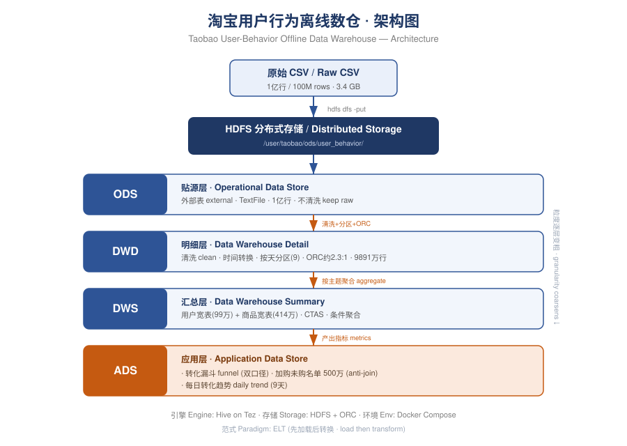
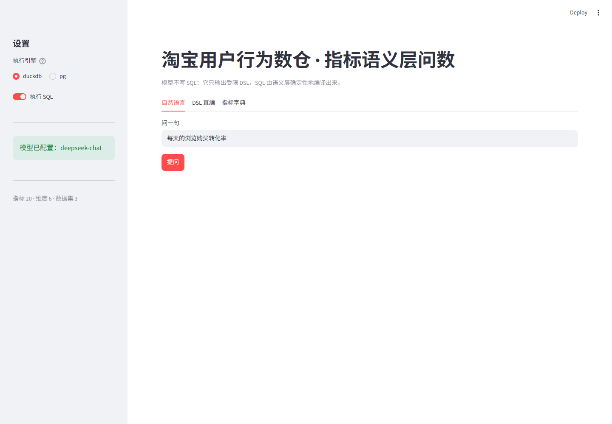

# Taobao User-Behavior Offline Data Warehouse

> A four-layer offline data warehouse built on **Hadoop + Hive**, processing **100 million rows** of Taobao user-behavior data — transforming raw event logs into business-ready metrics such as conversion funnels and re-marketing lists.




---

## Table of Contents

- [What This Project Does](#what-this-project-does)
- [Tech Stack](#tech-stack)
- [Dataset](#dataset)
- [Warehouse Layers](#warehouse-layers)
- [Key Results](#key-results)
- [Data Skew Study](#data-skew-study)
- [Quick Start](#quick-start)
- [Project Structure](#project-structure)
- [Technical Highlights](#technical-highlights)
- [Engineering Challenges Solved](#engineering-challenges-solved)

---

## What This Project Does

This project takes **3.4 GB of raw e-commerce behavior logs** (roughly 100 million rows) and turns them into a clean, layered data warehouse that answers real business questions.

The pipeline follows the **ELT** paradigm — raw data is loaded first, then transformed layer by layer inside the warehouse:

```
Raw CSV (100M rows)  →  HDFS  →  ODS  →  DWD  →  DWS  →  ADS  →  Business metrics
```

Everything runs locally through **Docker Compose**, so the entire environment is reproducible on a single machine.

---

## Tech Stack

| Layer | Technology |
|-------|-----------|
| **Storage** | HDFS (Hadoop 3.2) |
| **Compute** | Hive 4.0 on Tez · Spark / PySpark |
| **Metastore** | Standalone Hive Metastore service · PostgreSQL 16 |
| **File format** | ORC (columnar) + Snappy compression |
| **Orchestration** | Docker Compose |
| **Language** | HiveSQL · Python |

---

## Dataset

Source: [Alibaba Tianchi — UserBehavior](https://tianchi.aliyun.com/dataset/649)

| Field | Type | Description |
|-------|------|-------------|
| `user_id` | BIGINT | User identifier |
| `item_id` | BIGINT | Item identifier |
| `category_id` | BIGINT | Category identifier |
| `behavior_type` | STRING | `pv` (view) / `cart` / `fav` / `buy` |
| `timestamp` | BIGINT | Event time (Unix seconds) |

- **Volume:** ~100,000,000 rows, 3.41 GB
- **Time range:** 2017-11-25 to 2017-12-03 (9 days)

---

## Warehouse Layers

Each layer has a single, well-defined responsibility. Granularity gets coarser as data moves up the stack.

| Layer | Full Name | Responsibility | Storage |
|-------|-----------|----------------|---------|
| **ODS** | Operational Data Store | Load raw data as-is, no cleaning | External table · TextFile |
| **DWD** | Data Warehouse Detail | Clean, convert timestamps, partition by day | ORC + Snappy |
| **DWS** | Data Warehouse Summary | Aggregate into user / item wide tables | ORC + Snappy |
| **ADS** | Application Data Store | Produce final business metrics | ORC |

---

## Key Results

### 1. Conversion Funnel

Computed with **two definitions** to avoid a common analytical trap:

| Definition | PV | Cart | Fav | Buy | Buy-Rate |
|-----------|-----|------|-----|-----|----------|
| Event count | 88.6M | 5.47M | 2.85M | 2.00M | **2.26%** |
| Unique user | 984K | 737K | 388K | 670K | **68.12%** |

> **Insight:** The two rates differ by ~30x — a single page-view converts at only 2.26%, yet **68% of active users eventually buy**. Exposing both definitions lets analysts pick the right lens instead of drawing the wrong conclusion from a single number.

### 2. Cart-Not-Buy List (Re-marketing Targets)

- **Size:** **4,981,518** high-intent records — users who added an item to cart but never purchased it.
- **Method:** an **anti-join** (`cart` events `LEFT JOIN` `buy` events, keeping rows with no match).
- **Value:** a ready-to-use segment for downstream re-marketing (coupons, reminders), delivered as a queryable table refreshed by the pipeline.

### 3. Daily Conversion Trend

Detected a **pre-promotion effect**: on Dec 2 (just before the "Double 12" sale), traffic spiked +30% while conversion dropped to its lowest. This pattern surfaces directly from the daily-partitioned ADS table.

---

## Data Skew Study

A tuning study layered on top of DWD. Profiling came first: this dataset is **not skewed** — the hottest item accounts for just **0.033%** of all rows, or 6.5% of an average partition. Rather than claim a problem that never occurred, a controlled skew scenario was constructed to validate the fixes.

**Setup:** 30% of rows were rewritten to a single hot item, pushing that key to **23.07%** of the table — **46x** an average partition.

| Strategy | Runtime | vs. Baseline | Accuracy |
|----------|---------|--------------|----------|
| `count` + `sum` (additive) | 12.3s | — *(control)* | Exact |
| `countDistinct` baseline | 76.9s | 1.00x | Exact |
| Two-phase dedup | 73.6s | 1.04x | Exact, zero diff |
| **HLL approximation** | **44.1s** | **1.74x** | 0.60% mean error |

> **Key finding:** even with a 23% hot key, `group by count` showed no skew at all — Shuffle Read Max/Median was just **1.03x**, because map-side combine compressed 128.6M rows down to 20.0M before the shuffle.
>
> `countDistinct` was **6.3x** slower, but not because of the hot key. The physical plan shows that Spark already splits a single `countDistinct` into two stages: one shuffle on `(item_id, user_id)`, which scatters the hot item across tasks, then one on `item_id`, which carries a single partial count per item per partition. The cost is volume — `(item_id, user_id)` pairs barely compress map-side. Hand-written two-phase dedup produces the identical plan, which is why it gained only 4%. HLL is what changes the plan: mergeable sketches allow map-side partial aggregation and a single shuffle, 1.74x faster at 0.60% mean error.
>
> **Read the plan before naming the problem: a hot key only hurts when it cannot be compressed before the shuffle.**

Full write-up, including HLL's error characteristics and why salting doesn't apply to distinct aggregations: [`docs/data_skew.md`](docs/data_skew.md)

---

## Semantic Layer & Ask-the-DW Agent

A metric layer sits on top of the warehouse, and **the model never writes SQL**:

```
NL question → metric retrieval (BM25) → constrained DSL → schema + semantic checks
            → deterministic compile → SQL → PostgreSQL (ms fast path) / Hive (detail)
```



| Piece | Responsibility | Evidence |
|---|---|---|
| `semantic/` | 20 metrics · 6 dimensions · 3 datasets — one source of truth | 30 SQL snapshots, 54 tests |
| `semantic/compiler.py` | DSL → SQL: partition pruning, ratio-from-one-dataset, declarative join paths, `dod`/`share` windows, cohort self-join | byte-identical output |
| `agent/` | 3-state output (`query` / `clarify` / `refuse`), structured repair loop (≤2 retries), **no SQL template in the prompt** | 19 tests, offline via `FakeLLM` |
| `eval/` | 60 questions: A25 answerable · B15 comparison · C10 must-clarify · D10 must-refuse | L1 **40/40** golden DSLs compile & execute |
| `app/` | Streamlit page: question → editable DSL → collapsible SQL → result + metric footnote | `AppTest` smoke test |

Why not let the model write SQL? Four failure modes it cannot fix by being bigger: metric-definition drift, join hallucinations, no audit trail, no regression. Constraining the model to a DSL moves the uncertainty into slot filling and keeps correctness in code.

Two definition traps this dataset really has — both encoded in the dictionary and locked by tests:

1. `dws_item_summary.user_cnt` is a **per-item distinct user count**; summing it across items double-counts users. So *category conversion rate* is defined as an **event-count ratio** (`SUM(buy)/SUM(pv)`), and the user-level version is a separate metric reading DWD.
2. Event-level and user-level conversion differ by **30x** (2.26% vs 68.12%). Both are legitimate, so the bare word "转化率" must trigger a clarification, not a guess.

```bash
pip install -r requirements-semantic.txt

python -m semantic validate                                 # dictionary self-check
python -m semantic compile --json '{"metrics":["buy_pv_rate"],"dimensions":["dt"]}'
python -m pytest semantic/tests agent/tests app/tests -q    # 74 tests
python tools/verify_metrics.py --pg-dsn postgresql://...    # real data: 10/10, PG == DuckDB
python eval/run_l1.py                                       # 40/40, no API key needed

streamlit run app/streamlit_app.py                          # demo page
python -m agent ask "每天的转化率"                            # needs DEEPSEEK_API_KEY in .env
```

Docs: [`docs/semantic_layer_design.md`](docs/semantic_layer_design.md) · [`semantic/README.md`](semantic/README.md)

---

## Quick Start

### Prerequisites

- Docker Desktop (WSL2 backend on Windows)
- Download `UserBehavior.csv` and place it under `D:/data/taobao_data/UserBehavior/` (or edit the mount path in `docker/docker-compose.yml`)

### Run

```bash
# 1. Start the stack (5 containers: namenode, datanode, metastore-db, hive-metastore, hive)
cd docker
docker compose up -d --build
# Wait 60-90s for Hive to become ready

# 2. Load the CSV into HDFS
bash ../scripts/load_to_hdfs.sh

# 3. Build every layer: ODS -> DWD -> DWS -> ADS
bash ../scripts/run_all.sh

# 4. Verify the results
docker cp ../sql/verify/verify_all.sql hive:/tmp/verify_all.sql
docker exec -it hive beeline -u jdbc:hive2://localhost:10000 -f /tmp/verify_all.sql
```

Web UIs: HDFS at `http://localhost:9870` · HiveServer2 at `http://localhost:10002`

On Windows without WSL integration, use the matching `.cmd` scripts in `scripts/` (`load_to_hdfs.cmd`, `run_all.cmd`, `verify.cmd`).

---

## Project Structure

```
taobao-user-behavior-dw/
├── README.md
├── docker/
│   ├── docker-compose.yml       # 5 containers: HDFS x2, PostgreSQL, Hive Metastore, HiveServer2
│   ├── hadoop.env               # Hadoop configuration
│   └── hive/Dockerfile          # apache/hive:4.0.0 + PostgreSQL JDBC driver
├── sql/
│   ├── 01_ods/
│   │   └── ods_user_behavior.sql        # External source table
│   ├── 02_dwd/
│   │   └── dwd_user_behavior.sql        # Clean + partition + ORC
│   ├── 03_dws/
│   │   ├── dws_user_summary.sql         # User-level wide table
│   │   └── dws_item_summary.sql         # Item-level wide table
│   ├── 04_ads/
│   │   ├── ads_conversion_funnel.sql    # Funnel (two definitions)
│   │   ├── ads_cart_not_buy.sql         # Cart-not-buy (anti-join)
│   │   └── ads_daily_conversion.sql     # Daily trend
│   └── verify/
│       └── verify_all.sql               # Verification queries
├── spark/
│   └── skew_experiment.py       # Controlled data-skew experiment (PySpark)
├── semantic/                    # Metric layer: the only place that defines a metric
│   ├── datasets.yml             #   tables, grain, declarative join paths
│   ├── dimensions.yml           #   how metrics can be sliced (enums enumerated)
│   ├── metrics.yml              #   20 metrics with business definitions + version
│   ├── registry.py              #   load + C0–C5 consistency checks
│   ├── validator.py             #   DSL validation (shape + semantics)
│   ├── compiler.py              #   DSL → SQL (deterministic, snapshot-tested)
│   ├── executor.py              #   DuckDB / PostgreSQL execution
│   └── tests/                   #   30 SQL snapshots + 54 tests
├── agent/                       # Ask-the-warehouse agent
│   ├── retriever.py             #   BM25 over metric cards + ambiguity detection
│   ├── prompt.py                #   three-state contract, no SQL templates
│   ├── pipeline.py              #   query / clarify / refuse + repair loop
│   ├── llm.py                   #   stdlib DeepSeek client
│   └── fake.py                  #   scripted LLM for offline tests
├── eval/
│   ├── questions.yml            # 60 questions (A/B/C/D)
│   ├── run_l1.py                # golden-DSL replay, no API key
│   └── run_l2.py                # real-model metrics + report
├── app/
│   └── streamlit_app.py         # demo page
├── tools/
│   ├── verify_metrics.py        # real-data check vs hand-written gold SQL
│   ├── sync_to_pg.py            # service layer → PostgreSQL (10.2M rows)
│   └── duckdb_warehouse.py      # local warehouse stand-in over Parquet
├── scripts/
│   ├── load_to_hdfs.sh / .cmd   # Load CSV into HDFS
│   ├── run_all.sh / .cmd        # Run all layer SQL in order, stop on the first failure
│   └── verify.sh / .cmd         # Run the verification queries
└── docs/
    ├── architecture.svg         # Architecture diagram
    ├── data_dictionary.md       # Full table schemas
    ├── data_skew.md             # Data-skew study write-up
    └── semantic_layer_design.md # Metric layer + agent design doc
```

---

## Technical Highlights

Core techniques applied across the pipeline, each chosen to improve data quality, query performance, or maintainability.

| Technique | What it does | Where |
|-----------|--------------|-------|
| **External table** | Dropping the table keeps the underlying data safe | ODS |
| **Dynamic partition** | Auto-creates a partition per date from the data | DWD |
| **ORC + compression** | Columnar storage, reads only needed columns; about **2.3:1** smaller than the raw CSV on HDFS | DWD / DWS |
| **Remote metastore** | Table metadata in PostgreSQL behind a standalone Hive Metastore; managed tables pinned to HDFS | Environment |
| **CTAS** | `CREATE TABLE AS SELECT` — build and load in one step | DWS / ADS |
| **Conditional aggregation** | `SUM(CASE WHEN ...)` computes multiple metrics in one scan | DWS / ADS |
| **Anti-join** | `LEFT JOIN ... WHERE key IS NULL` finds "in A but not in B" | ADS |
| **UNION ALL** | Merges two funnel definitions into one table | ADS |
| **Map-side combine** | Additive aggregations merge locally before the shuffle — inherently skew-resistant | Skew study |
| **Two-phase aggregation** | What Spark already plans for a single `countDistinct`: shuffle on `(item_id, user_id)`, then on `item_id` | Skew study |
| **HLL approximation** | Mergeable sketches allow map-side partial aggregation and a single shuffle — **1.74x** speedup | Skew study |

---

## Engineering Challenges Solved

Real problems encountered and fixed during development — the kind of debugging that happens in production.

1. **Metastore kept crashing, then outgrew Derby.**
   The first image (bde2020) ran a separate metastore container that died from a startup race condition, so I switched to the official `apache/hive:4.0.0` image with embedded Derby. Derby then became the limit: it allows only one session at a time and keeps `metastore_db` inside the container. The current setup runs a standalone Hive Metastore service on port 9083, backed by PostgreSQL 16, with HiveServer2 connecting to it through `hive.metastore.uris`.
   *Lesson: get it working on a proven setup first, then replace the parts that will not hold up.*

2. **Large-file transfer stalled the container.**
   `docker cp` on a 3.4 GB file froze the container. Switched to a **volume mount** so the container reads the local file directly — zero copy. This is also the standard way to handle large files in production.

3. **`file:/` vs `hdfs://` path resolution.**
   An external table's `location` written as a relative path was resolved against the local filesystem and failed. Fixed by using the full HDFS URI: `hdfs://namenode:9000/...`.

4. **Metastore data loss on container rebuild.**
   Rebuilding the Hive container deleted the embedded Derby metastore along with it, wiping all table definitions (the HDFS data survived). The first fix persisted Derby to a Docker volume; the final fix moved the metadata into a dedicated PostgreSQL service with its own named volume, and pinned `hive.metastore.warehouse.dir` to `hdfs://namenode:9000/user/hive/warehouse` — without it, managed tables were written into the container's writable layer.
   *Lesson: this is exactly why production metastores live in dedicated, persistent storage.*

5. **Built a hot key, measured no skew.**
   After forcing one item to 23% of the table (46x an average partition), `group by count` still ran perfectly balanced — Shuffle Read Max/Median was **1.03**. The Spark UI revealed why: only 20M records crossed the shuffle, because map-side combine had already flattened the hot key. `countDistinct` was 6.3x slower, but its physical plan showed two shuffles keyed on `(item_id, user_id)` and then `item_id`, so the hot key never landed on one task — the extra time was shuffle volume, not skew.
   *Lesson: additive aggregations are inherently skew-resistant, and the physical plan, not the runtime alone, tells you whether a slow job is actually skewed.*

---

## License

For learning and portfolio purposes only. Dataset © Alibaba Tianchi.
